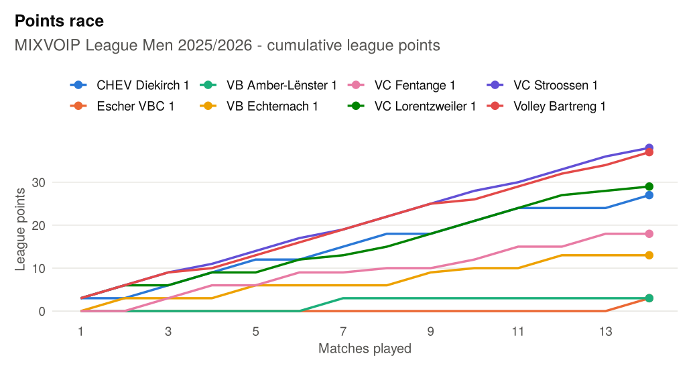
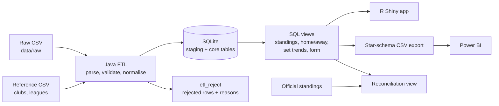
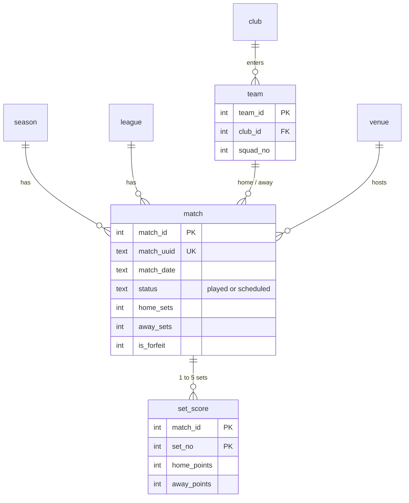
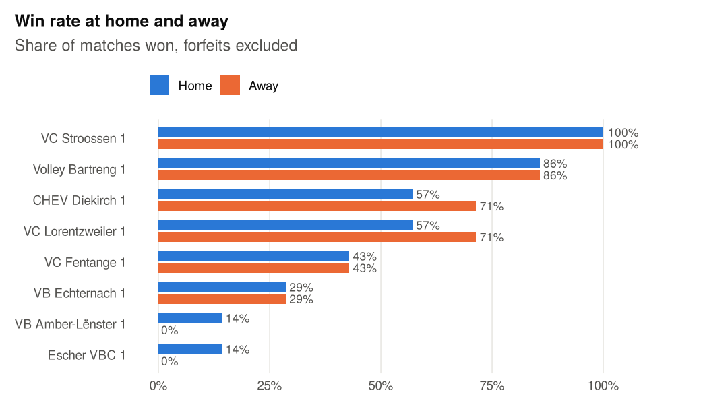
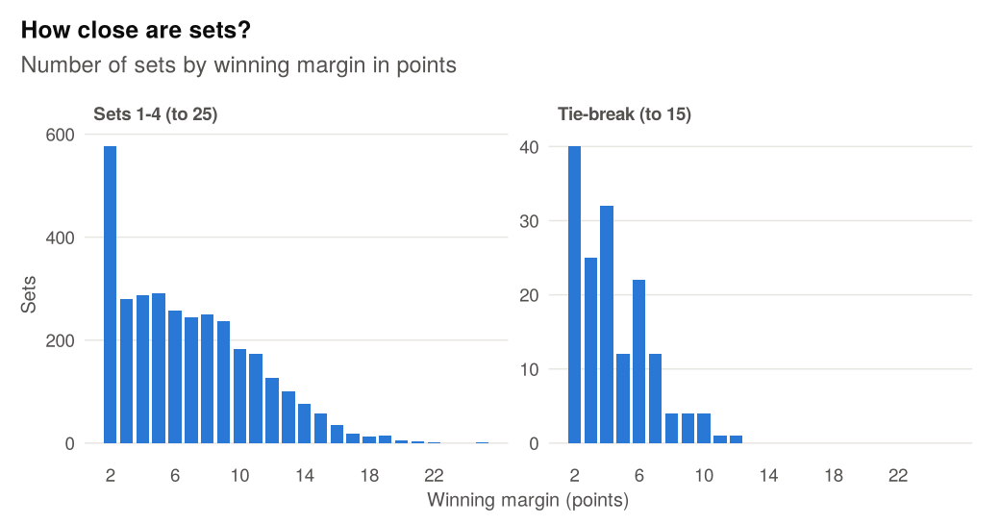
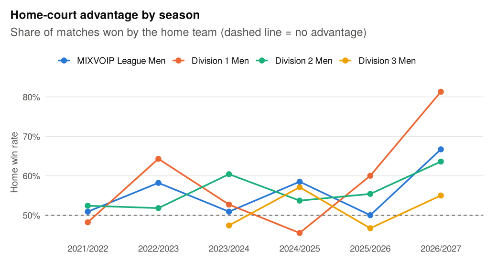

# FLVB Volleyball Data Pipeline

An end-to-end data engineering project on public volleyball results from
Luxembourg's federation (FLVB): **Java** ingests and validates raw CSV,
**SQL** models and analyses it, and the results are served through an
**R Shiny** app and a **Power BI**-ready dataset.

It runs out of the box on the real data included in the repository:
1,254 raw rows covering 6 seasons and 4 men's divisions.



## What it demonstrates

- **Ingestion with validation, not just loading.** Every raw row is either loaded or written to a reject table with a reason code; nothing disappears silently.
- **Entity resolution.** The federation renamed its teams three times in six years (`VCS Hommes` -> `VCS Hommes 1` -> `VC Stroossen 1`); 81 raw names resolve to 38 teams.
- **A relational model with real constraints**: keys, checks, indexes, and volleyball's scoring rules enforced in both Java and SQL.
- **An analytical SQL layer** (window functions, unpivoting, gaps-and-islands) that is the single source of truth for both front ends.
- **Reconciliation against an independent source.** Standings computed from match rows are compared with the federation's published tables: 166 of 168 rows identical, and the other 2 are explained.
- **Reproducibility**: full-refresh, idempotent, single-transaction load; unit and integration tests; CI.

## Architecture



| Layer | Technology | Where |
|---|---|---|
| Ingestion / ETL | Java 17, JDBC, Maven (one dependency: the SQLite driver) | `etl/` |
| Storage and modelling | SQLite: schema, constraints, indexes, views | `sql/` |
| Interactive analysis | R Shiny, ggplot2, bslib | `shiny/` |
| Reporting | Power BI: star schema, DAX measures, build guide | `powerbi/` |

SQLite was chosen so the project runs with no database server to install. The
SQL is standard apart from a few SQLite idioms and ports to PostgreSQL with
small changes (noted under Roadmap).

## Data model



Views built on top (`sql/02_views.sql`):

| View | Purpose |
|---|---|
| `v_match` | one row per match with readable labels |
| `v_team_match` | two rows per match, one per team: the main fact for team analysis |
| `v_standings` | league table per season and division, ranked with `RANK()` |
| `v_home_away`, `v_league_home_advantage` | home vs away performance |
| `v_set`, `v_set_trends`, `v_team_set_profile` | set-level analysis |
| `v_team_form` | cumulative points and rolling last-5 win rate |
| `v_head_to_head` | record between any two teams |
| `v_standings_reconciliation`, `v_dq_summary` | data-quality controls |

## How to run

**Requirements:** JDK 17+, Maven 3.8+, R 4.2+ (for the app), Power BI Desktop (optional).

```bash
git clone <your-repo-url>
cd flvb-volleyball-pipeline

# 1. Build the database and the Power BI dataset (about 2 seconds)
cd etl
mvn test                 # 40 unit and integration tests
mvn compile exec:java    # runs the pipeline -> build/volleyball.db, powerbi/data/*.csv
cd ..

# 2. Explore with SQL
sqlite3 -header -column build/volleyball.db < sql/03_analysis_queries.sql

# 3. Start the Shiny app
Rscript -e 'install.packages(c("shiny", "bslib", "DBI", "RSQLite", "ggplot2", "DT"))'   # first time only
Rscript -e 'shiny::runApp("shiny", launch.browser = TRUE)'
```

Or in one step: `./run.sh` (Linux/macOS) or `.\run.ps1` (Windows).

For Power BI, follow [`powerbi/README.md`](powerbi/README.md): load the CSVs,
create five relationships, paste the DAX measures.

Pipeline output:

```text
[1/3] Loading ../data/raw/flvb_men_matches.csv -> ../build/volleyball.db
      rows read: 1254 | matches loaded: 1131 | sets loaded: 3428 | rejected: 123 | warnings: 17
[2/3] Data-quality report
      severity                        reason_code                     rows
      REJECT                          DUPLICATE_MATCH                 112
      REJECT                          UNKNOWN_TEAM                    10
      REJECT                          INVALID_DATE                    1
      WARNING                         STANDINGS_WITHOUT_MATCHES       16
      WARNING                         DURATION_OUT_OF_RANGE           1
      standings_rows_checked          standings_rows_reconciled       matches_with_set_count_mismatch
      168                             166                             0
[3/3] Exporting Power BI dataset -> ../powerbi/data
```

## Sample results

All figures come from `sql/03_analysis_queries.sql` on the included data
(950 played matches, 3,386 sets, snapshot of 16 November 2026).

**Top division, 2026/2027 season in progress**

| # | Team | P | W | L | Pts | Sets | Ball ratio |
|---|---|---|---|---|---|---|---|
| 1 | CHEV Diekirch 1 | 3 | 3 | 0 | 9 | 9:0 | 1.268 |
| 2 | VC Lorentzweiler 1 | 4 | 3 | 1 | 8 | 9:5 | 1.127 |
| 3 | VC Stroossen 1 | 3 | 2 | 1 | 7 | 8:3 | 1.411 |
| 4 | Volley Bartreng 1 | 3 | 2 | 1 | 6 | 6:3 | 1.056 |
| 5 | VC Fentange 1 | 4 | 1 | 3 | 3 | 5:11 | 0.867 |
| 6 | VB Echternach 1 | 4 | 1 | 3 | 3 | 3:9 | 0.874 |
| 7 | VC Belair 1 | 3 | 0 | 3 | 0 | 0:9 | 0.618 |

This table is computed from match rows and matches the one published by the federation.

**A few findings**

- **Home advantage is real but modest:** the home team wins 54.6% of matches (51.5% to 55.6% depending on the division).
- **The first set is a strong signal:** the winner of set 1 wins the match 82.6% of the time.
- **Sets get tighter as a match goes on:** the average winning margin falls from 7.1 points in set 1 to 6.1 in set 4, and a quarter of tie-breaks (25.5%) are decided by the minimum two points.
- **Longest winning streak:** VC Stroossen 1 won 41 league matches in a row between October 2021 and January 2024 (gaps-and-islands query, Q7).

| Home vs away | Set margins |
|---|---|
|  |  |



## Data quality

The source is messier than it looks, which is what makes it a useful exercise:
duplicated matches listed under two divisions, placeholder teams, a date cell
containing the word "Postponed", a 18,885-minute match, forfeits recorded as
25:0 sets, and team names that change every other season. Each case, how it is
handled and the reconciliation results are documented in
[`docs/data_quality.md`](docs/data_quality.md).

## The Shiny app

Five tabs, with season, division and team filters:

| Tab | Content |
|---|---|
| Rankings | league table, points race with team highlighting |
| Team | KPIs, results by score, set win rate by set number, rolling form, match list |
| Home / Away | win rate at home and away per team, home advantage by season and division |
| Set trends | winning margin and close-set share by set number, margin distribution |
| Data quality | load counts, reject reasons, differences from the official standings |

The app contains no business logic: it filters the SQL views with
parameterised queries and plots the result.

## Repository layout

```text
data/raw/            raw CSV exactly as published (matches, official standings)
data/reference/      hand-maintained lookups (clubs, leagues)
etl/                 Java ETL (Maven project) and tests
sql/                 01_schema.sql, 02_views.sql, 03_analysis_queries.sql
shiny/               app.R and R/plots.R (chart functions)
powerbi/             exported star schema, theme, dashboard build guide
docs/                data source, data quality notes, README figures
scripts/             make_readme_figures.R
.github/workflows/   CI: tests, pipeline run, export drift check
```

## Design decisions

- **Full refresh in one transaction.** At this size, rebuilding is simpler and safer than incremental logic; a failed run leaves the previous database untouched.
- **Staging table kept.** `stg_match_raw` stores the input unchanged so any loaded value can be traced to its source line.
- **Rules in SQL views, not in the dashboards.** Shiny and Power BI read the same views or their exports, so they cannot disagree.
- **Hand-written CSV parser.** Fifty lines, fully tested, and it keeps the runtime dependencies down to the JDBC driver.
- **Natural key for deduplication.** The federation's match id identifies a match; surrogate integer keys are assigned in chronological order for compact joins.

## Roadmap

- Parse the per-match statistical reports (serve, reception, attack, block per player) into a `player_match_stats` table.
- Incremental loads keyed on match id, scheduled weekly during the season.
- PostgreSQL target: replace `WITHOUT ROWID`, `GLOB` checks and boolean-as-integer sums; the views are otherwise portable.
- Women's championship and cup competitions.

## Data and licence

Match results are public information published by the
[Fédération Luxembourgeoise de Volleyball](https://flvb.lu). This project is
not affiliated with the FLVB. Code is released under the MIT licence.
